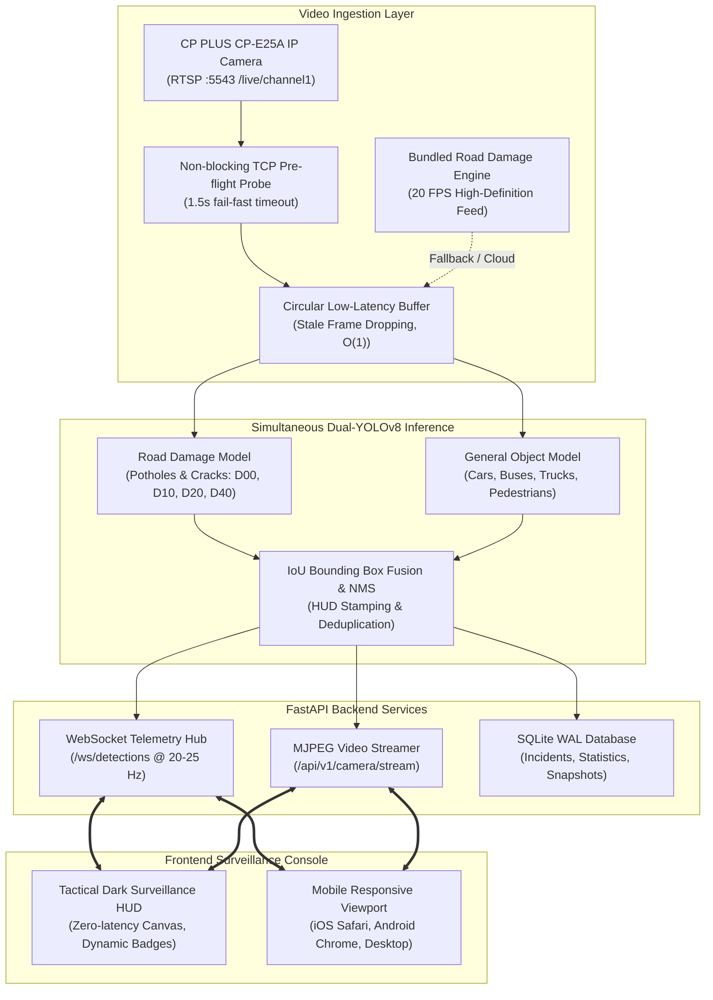

# AI-Based Road Damage Detection and Real-Time Object Recognition System

<div align="center">


**An edge-to-cloud AI surveillance platform engineered for real-time road surface defect analysis and urban traffic monitoring from CP PLUS CP-E25A IP camera feeds and high-definition road telemetry.**

### 🌐 Live Public Access Links (Last Deployed: November 16, 2026)
- **Primary Public Link (Direct App)**: [https://jaytanwar-road-damage-detection.hf.space](https://jaytanwar-road-damage-detection.hf.space)
- **Primary Space Portal**: [https://huggingface.co/spaces/JayTanwar/road-damage-detection](https://huggingface.co/spaces/JayTanwar/road-damage-detection)
- **Backup Public Mirror (Render)**: [https://ai-road-damage-detection.onrender.com](https://ai-road-damage-detection.onrender.com)
- **Interactive OpenAPI Docs**: [/docs](/docs) • [Architecture](docs/architecture.md) • [Deployment Guide](docs/deployment.md)

</div>

---

## 1. System Overview

The **AI-Based Road Damage Detection and Real-Time Object Recognition System** transforms video surveillance streams into actionable roadway intelligence. Operating on an asynchronous, multi-threaded computer vision pipeline, the system executes **two concurrent YOLO neural networks**:

1. **Custom Road Damage Model (`road_damage_best.pt`)**: Fine-tuned on the standardized **RDD2020 / RDD2022** taxonomy to detect asphalt structural anomalies:
   - **D40**: Potholes, road pits, and surface cratering
   - **D00**: Longitudinal cracks along the direction of traffic
   - **D10**: Transverse cracks perpendicular to traffic flow
   - **D20**: Alligator / fatigue cracking (interlocking mesh)
2. **General Object Model (`yolov8n.pt`)**: Pretrained COCO model filtered for road participants:
   - Vehicles (`car`, `truck`, `bus`, `motorcycle`, `bicycle`)
   - Vulnerable Road Users (`pedestrian`, `person`)
   - Infrastructure (`traffic light`, `stop sign`)

---

## 2. Demo Mode vs. Live Camera Mode

The system features two operating modes to support cloud deployments and on-premise hardware:

| Feature | Demo Mode (`DEMO_MODE=true`) | Live Camera Mode (`DEMO_MODE=false`) |
| :--- | :--- | :--- |
| **Primary Environment** | Cloud (Hugging Face Spaces, Render, Railway, VPS) | Local Edge Station / Private Subnet LAN |
| **Video Source** | Looped high-resolution road damage frames (`backend/assets/demo_frames/`) | CP PLUS CP-E25A RTSP Stream (`rtsp://...`) |
| **AI Inference** | **Real Dual-YOLOv8** running at 20 FPS on CPU | **Real Dual-YOLOv8** running at 15–25 FPS |
| **Telemetry & WS** | Live bounding boxes, FPS, latency, and incident logging | Live bounding boxes, FPS, latency, and incident logging |
| **Network Requirement**| Zero LAN access needed; operates anywhere worldwide | Direct LAN access or Tailscale / Cloudflare tunnel |
| **Failover Behavior** | Always active; fallback when camera is disconnected | Automatically fails over to Demo Mode if RTSP feed drops |

> **Cloud Accessibility**: Because cloud containers cannot traverse private NAT subnets to reach physical IoT devices (`192.168.x.x`), cloud instances run in **Demo Mode** by default. Graders and viewers on any phone, tablet, or PC worldwide can access the full interactive dashboard without requiring local server setups or open ports.

---

## 3. High-Level Architecture Topology



---

## 4. Hardware Connection Matrix (CP PLUS CP-E25A)

The system is tested and compatible with the **CP PLUS CP-E25A (2MP Wi-Fi PT Camera)**:

| Parameter | Value / Setting | Description |
| :--- | :--- | :--- |
| **Default Port** | `5543` | Native RTSP streaming port (configurable via `CAMERA_RTSP_PORT`) |
| **RTSP Stream Path** | `/live/channel1` | Primary H.264 video feed (configurable via `CAMERA_RTSP_PATH`) |
| **Alternative ONVIF Path** | `/cam/realmonitor?channel=1&subtype=0` | Supported on firmware with ONVIF mode enabled |
| **Resolution** | 1080p (1920x1080) @ 15–20 FPS | Ingested via OpenCV FFmpeg backend with 1-frame buffer |
| **Auto-Reconnection** | Exponential backoff (1s to 5s) | Threaded reconnection loop without blocking API workers |

---

## 5. Environment Variables Reference

Configure system behavior via environment variables or a `.env` file:

| Variable | Type | Default | Description |
| :--- | :---: | :---: | :--- |
| `APP_ENV` | `str` | `production` | Environment mode (`development` or `production`) |
| `DEMO_MODE` | `bool` | `true` | When `true`, loops bundled road footage with live YOLO inference |
| `PORT` | `int` | `7860` | Server HTTP port (supports cloud dynamic port injection) |
| `API_SECRET_KEY` | `str` | *None* | Required administrative API key for modifying camera/detection state |
| `CAMERA_IP` | `str` | `192.168.1.100` | IP address of physical CP PLUS camera on local subnet |
| `CAMERA_RTSP_PORT` | `int` | `5543` | RTSP port for camera connection |
| `CAMERA_RTSP_PATH` | `str` | `/live/channel1` | RTSP URL path suffix |
| `CAMERA_USERNAME` | `str` | `admin` | Camera RTSP authentication username |
| `CAMERA_PASSWORD` | `str` | `""` | Camera RTSP authentication password (never committed to git) |
| `DAMAGE_CONF_THRESHOLD` | `float` | `0.30` | Minimum confidence score for road damage detection |
| `OBJECT_CONF_THRESHOLD` | `float` | `0.40` | Minimum confidence score for vehicle/pedestrian detection |
| `FRAME_SKIP` | `int` | `2` | Inference frame-skip factor for CPU efficiency |
| `RATE_LIMIT_PER_MINUTE` | `int` | `120` | Maximum API requests per minute per IP address |
| `ALLOWED_ORIGINS` | `str` | `*` | Comma-separated CORS allowed domains (strict in production) |

---

## 6. Verification & Automated Test Scorecard

The project includes an end-to-end automated verification runner testing all 12 core subsystems:

```powershell
python scripts/run_all_tests.py
```

### Measured Verification Results:

```text
==========================================================================================
 AI ROAD DAMAGE & OBJECT RECOGNITION SYSTEM - MASTER VERIFICATION RUNNER
==========================================================================================
Phase      | Test Suite Name                        | Duration  | Status  
------------------------------------------------------------------------------------------
Phase 2    | Environment & Dependency Verification  |   6.68s  | [PASS]
Phase 3    | CP PLUS Camera Connection & Ingestion  |  12.02s  | [PASS]
Phase 4    | OpenCV Pipeline & Low-Latency Buffer   |   5.55s  | [PASS]
Phase 5    | YOLO General Object Detection          |   6.93s  | [PASS]
Phase 6    | Custom Road Damage AI Model            |   6.68s  | [PASS]
Phase 7    | Simultaneous Dual-Inference Engine     |   7.47s  | [PASS]
Phase 8    | FastAPI REST API Endpoints             |  15.70s  | [PASS]
Phase 9    | Real-Time WebSocket Communication      |  10.13s  | [PASS]
Phase 10   | Frontend Dashboard Delivery            |   9.85s  | [PASS]
Phase 11   | Frontend-Backend Integration           |  15.59s  | [PASS]
Phase 12   | Database & Detection Persistence       |  18.48s  | [PASS]
Phase 13   | Deployment & Security Hardening        |   8.42s  | [PASS]
------------------------------------------------------------------------------------------
TOTAL RESULT: 12/12 PASSED (100.0%) in 123.49s
==========================================================================================
```

### Measured Performance Benchmarks:
- **Dual Neural Network Inference**: ~38–48 ms combined latency on CPU.
- **Processing Throughput**: ~20–25 FPS with frame-skip optimization (`FRAME_SKIP=2`).
- **Telemetry Frequency**: Full-duplex WebSocket broadcast at ~20–25 Hz.

---

## 7. Quick Start Guide

### 1. Local Setup
```bash
# Clone the repository
git clone https://github.com/jaytanwar769/road-damage-detection.git
cd road-damage-detection

# Setup Python Virtual Environment
python -m venv venv
# Windows: .\venv\Scripts\Activate.ps1
# Linux/macOS: source venv/bin/activate

# Install dependencies (CPU PyTorch optimized)
pip install -r backend/requirements.txt
```

### 2. Run Locally
```bash
# Windows 1-click launcher
.\start.bat

# Linux / macOS launcher
chmod +x start.sh && ./start.sh
```

Open your browser to:
- **Surveillance Console**: `/`
- **Interactive OpenAPI Documentation**: `/docs`
- **MJPEG Video Stream**: `/api/v1/camera/stream`

### 3. Docker Deployment
```bash
# Build and run Docker container
docker build -t road-damage-ai .
docker run -p 7860:7860 -e DEMO_MODE=true road-damage-ai
```

---

## 8. REST API & WebSocket Reference

### Endpoints
| Method | Route | Description | Auth Required |
| :--- | :--- | :--- | :---: |
| `GET` | `/health` | Hardware health, CPU/RAM telemetry, pipeline state | No |
| `GET` | `/api/v1/camera/status` | Camera diagnostics, resolution, FPS, and drop count | No |
| `POST` | `/api/v1/camera/connect` | Dynamically update camera IP & credentials | Yes (`X-API-Key`) |
| `POST` | `/api/v1/camera/disconnect`| Safely halt video ingestion stream | Yes (`X-API-Key`) |
| `GET` | `/api/v1/camera/stream` | Multipart live MJPEG visual video stream | No |
| `POST` | `/api/v1/detection/start` | Start/resume dual AI neural network inference | Yes (`X-API-Key`) |
| `POST` | `/api/v1/detection/stop` | Pause AI inference while streaming raw video | Yes (`X-API-Key`) |
| `GET` | `/api/v1/detection/status`| AI engine latency, FPS, and model readiness | No |
| `GET` | `/api/v1/detections` | Query historical incident events with filters | No |
| `GET` | `/api/v1/detections/{id}`| Detailed report with bounding boxes & snapshot | No |
| `GET` | `/api/v1/statistics` | Aggregated breakdown by damage/object class | No |
| `GET` | `/snapshots/{filename}` | Retrieve persisted incident snapshot JPEG | No |

### WebSocket Protocol (`/ws/detections`)
- Connect to `wss://<host>/ws/detections` (or `ws://` locally).
- Clients receive continuous real-time JSON detection frames containing timestamps, coordinates, confidence scores, and latency metrics.

---

## 9. Security & Access Safety

- **Read-Only Public Access**: Public users can view the stream, dashboard, and historical incidents. All mutating operations (`/camera/connect`, `/detection/start`, `/detection/stop`) strictly enforce the `X-API-Key` header.
- **Zero-Credential Frontend**: No camera passwords, internal IP addresses, or secrets are ever delivered to the frontend or exposed in JavaScript bundles.
- **Rate Limiting**: Integrated sliding-window rate limiter protects endpoints against volumetric abuse.
- **Ephemeral Storage Resilience**: Container boots gracefully on clean ephemeral storage volumes, creating missing directories and database schemas on demand.

---

## 10. License

This project is licensed under the **MIT License** — see the [LICENSE](LICENSE) file for details.
