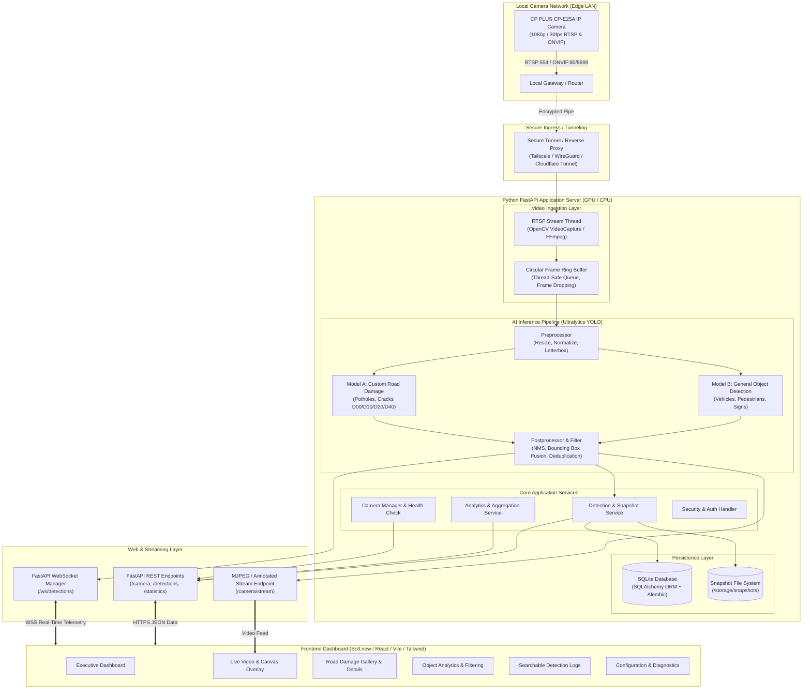
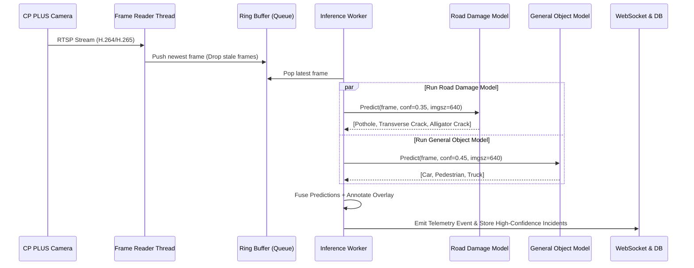
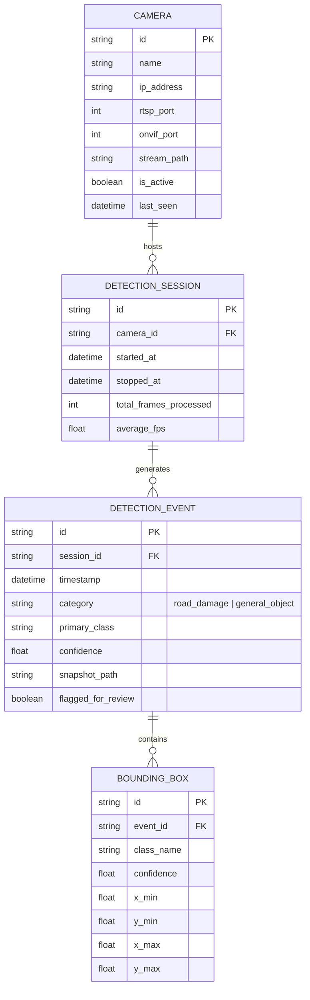

# AI-Based Road Damage Detection & Real-Time Object Recognition System
## System Architecture & Technical Specification (Phase 1)

---

### 1. Executive Summary & System Vision
The **AI-Based Road Damage Detection and Real-Time Object Recognition System** is an end-to-end computer vision and IoT analytics platform designed to:
- Intercept live video from industrial/surveillance IP cameras (specifically the **CP PLUS CP-E25A**).
- Decode and preprocess real-time RTSP streams via a resilient OpenCV multi-threaded ingestion pipeline.
- Concurrently execute dual Ultralytics YOLO models:
  1. **Road Damage Model**: Custom-trained on standardized road damage datasets (e.g., RDD2020 / RDD2022) to detect structural anomalies (potholes, longitudinal cracks, transverse cracks, alligator cracking).
  2. **General Object Model**: Pretrained YOLO (e.g., YOLOv8n/s or YOLO11n/s) to track road-dwelling objects (vehicles, trucks, buses, motorcycles, pedestrians, animals, traffic signals).
- Broadcast low-latency visual feeds and structured telemetry via WebSockets and REST APIs to a modern React/Tailwind web dashboard.
- Persist detections, telemetry, metrics, and incident snapshots in an extensible SQLite database (architected for seamless PostgreSQL migration).
- Provide secure public access through cloud-native reverse proxies and network tunneling (Tailscale / Cloudflare Tunnel) without exposing local camera credentials or unencrypted RTSP streams to the public internet.

---

### 2. High-Level Architectural Topology

---

### 3. Hardware & Camera Specifications (CP PLUS CP-E25A)

| Parameter | Specification | Integration Strategy |
| :--- | :--- | :--- |
| **Model** | CP PLUS CP-E25A EzyKam / Wi-Fi IP Camera | 2MP Full HD IP Camera |
| **Video Resolution** | 1080p (1920x1080) @ 20-30 fps | Scaled to 640x640 / 720p for AI inference to conserve VRAM |
| **Compression** | H.264 / H.265 | Handled transparently by FFmpeg backend in OpenCV |
| **Streaming Protocol** | RTSP (Real-Time Streaming Protocol) | Default port 554; path configured dynamically via `.env` |
| **Management Protocol** | ONVIF Profile S | Discovery on port 80 / 8899 / 8000 for profile retrieval |
| **Network Interfaces** | Wi-Fi (2.4 GHz) / RJ45 Ethernet | Requires static IP or DHCP reservation on local gateway |
| **Credential Security** | Username & Password | Never passed to client; held server-side in secure vault / `.env` |

#### Standard RTSP URL Patterns for CP PLUS:
1. `rtsp://<username>:<password>@<ip_address>:<port>/cam/realmonitor?channel=1&subtype=0` (Main Stream - High Res)
2. `rtsp://<username>:<password>@<ip_address>:<port>/cam/realmonitor?channel=1&subtype=1` (Sub Stream - Low Res / Detection Friendly)
3. `rtsp://<username>:<password>@<ip_address>:<port>/live/ch0` (Alternative firmware)
4. `rtsp://<username>:<password>@<ip_address>:<port>/onvif1` (Standard ONVIF mapping)

---

### 4. Technology Stack Selection & Rationales

| Layer | Technology | Version | Selection Justification |
| :--- | :--- | :--- | :--- |
| **AI Framework** | Ultralytics YOLO | v8 / v11 (PyTorch) | State-of-the-art real-time speed, high accuracy on edge GPUs/CPUs, flexible export options (ONNX, TensorRT). |
| **Computer Vision** | OpenCV (`opencv-python-headless`) | >= 4.9.0 | Low-latency stream decoding, image transformations, color space conversions, bounding box overlays. |
| **Backend Framework** | FastAPI + Uvicorn | >= 0.110.0 | High-performance asynchronous execution, native WebSocket support, automatic OpenAPI/Swagger documentation, Pydantic validation. |
| **ORM / Persistence** | SQLAlchemy + Alembic + SQLite | 2.0+ | Zero-configuration local database with clean abstractions, allowing one-click transition to PostgreSQL in production. |
| **Frontend Framework** | React + TypeScript + Vite | React 18+ | Lightning-fast HMR, strict type safety, modular component tree, excellent ecosystem compatibility with Bolt.new. |
| **Styling & UI** | Tailwind CSS + Lucide Icons | Latest | Modern dark-mode surveillance UI, zero runtime CSS overhead, accessible responsive layouts. |
| **Streaming Protocol** | WebSocket + MJPEG / Base64 | RFC 6455 | High-frequency telemetry (30 fps metadata) paired with optimized frame streaming without complex WebRTC gateway overhead. |
| **Deployment / Proxy** | Cloudflare Tunnel / Tailscale | Latest | Exposes private backend to public internet over HTTPS/WSS without opening router ports or exposing camera to attackers. |

---

### 5. AI Detection Architecture: Dual-Model Pipeline

#### Supported Damage Classes (Target Dataset Standard - RDD2020 / RDD2022):
- **D00**: Longitudinal Crack (along the direction of traffic)
- **D10**: Transverse Crack (perpendicular to traffic direction)
- **D20**: Alligator Crack / Fatigue Cracking (mesh/net pattern)
- **D40**: Pothole / Road Pit / Broken Surface
- **D43 / D44**: Crosswalk blur, lane line blur (optional surface wear)

#### Supported General Object Classes (COCO 80 Standard):
- Vehicles: `car`, `motorcycle`, `bus`, `truck`, `bicycle`
- Vulnerable Road Users: `person`, `dog`, `cat`
- Infrastructure: `traffic light`, `stop sign`

---

### 6. Data Model & Entity Relationship (ER) Design

---

### 7. Security, Networking & Public Accessibility Strategy

1. **Zero Credential Exposure**:
   - The React frontend receives **zero** camera IP addresses, passwords, or raw RTSP links.
   - All camera communication is negotiated server-side by FastAPI.
2. **Network Isolation & Secure Remote Tunneling**:
   - Camera sits in an isolated IoT VLAN on the edge network.
   - The backend runs on a host with access to the IoT VLAN and creates an outbound encrypted tunnel (Cloudflare Tunnel `cloudflared` or Tailscale Funnel) to a public domain (e.g., `https://road-ai.yourdomain.com`).
   - No inbound router ports (Port 554, 80, 8000) are opened to the public internet.
3. **Authentication & Authorization**:
   - API key or JWT Bearer authentication on sensitive endpoints (`/camera/connect`, `/detection/start`).
   - Rate limiting on control endpoints to prevent camera DoS or buffer exhaustion.

---

### 8. Phase Breakdown & Execution Roadmap

- **Phase 1 (Current)**: Architecture, Specifications, and Technical Blueprint.
- **Phase 2**: Python Environment Setup, Dependencies & Project Directory Scaffolding.
- **Phase 3**: CP PLUS Camera RTSP/ONVIF Connectivity, Diagnostics & Reconnect Engine.
- **Phase 4**: Multi-Threaded Real-Time Video Processing & Latency Control Pipeline.
- **Phase 5**: YOLO General Object Detection Integration (COCO Classes).
- **Phase 6**: Custom Road Damage Model Preparation & Training Pipeline (RDD Dataset).
- **Phase 7**: Simultaneous Dual-Inference Engine & Telemetry Fusion.
- **Phase 8**: FastAPI REST API Backend with Modular Routers.
- **Phase 9**: Real-Time WebSocket Streaming Engine for Low-Latency Telemetry.
- **Phase 10**: Bolt.new Frontend Dashboard (React + TypeScript + Tailwind CSS).
- **Phase 11**: Frontend-Backend End-to-End Integration & Real-Time Canvas Rendering.
- **Phase 12**: Database Persistence, Snapshot Storage, and Searchable History.
- **Phase 13**: Remote Camera Tunneling & Production Deployment Setup.
- **Phase 14**: System Hardening, Benchmarking, Open-Source Documentation & GitHub Release.
